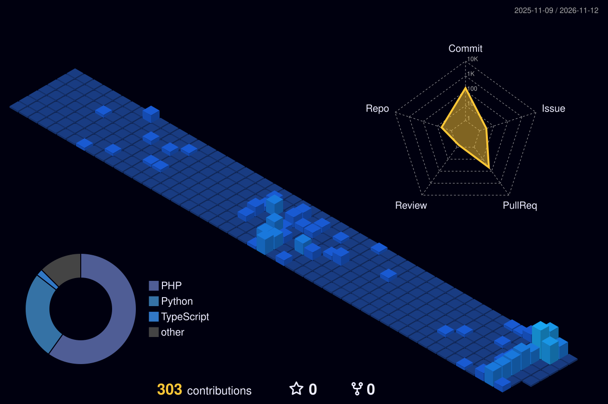

 

## TECH STACK

### `LANGUAGES`

### `DATABASE & TOOLS`

### `CURRENTLY EXPLORING`

## 3D CONTRIBUTION UNIVERSE

  <i>Every contribution is another block in the world I'm building.</i>

## CONNECT

<!-- Add your LinkedIn, portfolio or email when ready. -->

  

**Building the future, one line at a time.**

