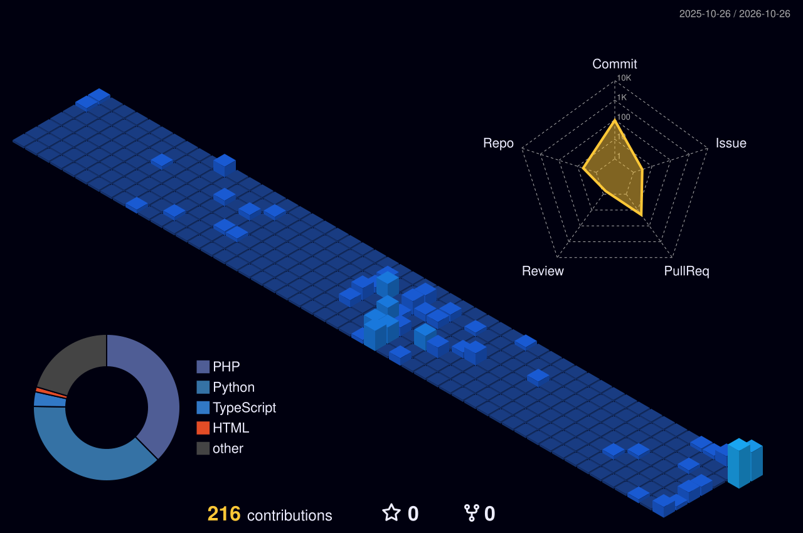

---

## 👨‍💻 Giới thiệu
- 🎓 Sinh viên CNTT
- 🔭 Đang học: Phát triển phần mềm, Học máy, Mạng máy tính
- 🌱 Thích làm các dự án nhóm và học công nghệ mới
- 📫 Liên hệ: daovanduong4112006a@gmail.com

---

## 🛠 Công nghệ

---

## 🧊 Biểu đồ đóng góp 3D

---

## 🏆 Thành tích

---

## 📈 Hoạt động

---

## 🐍 Rắn ăn contribution

<picture>
  <source media="(prefers-color-scheme: dark)" srcset="https://raw.githubusercontent.com/duogvdao206/duogvdao206/output/github-snake-dark.svg" />
  
</picture>

